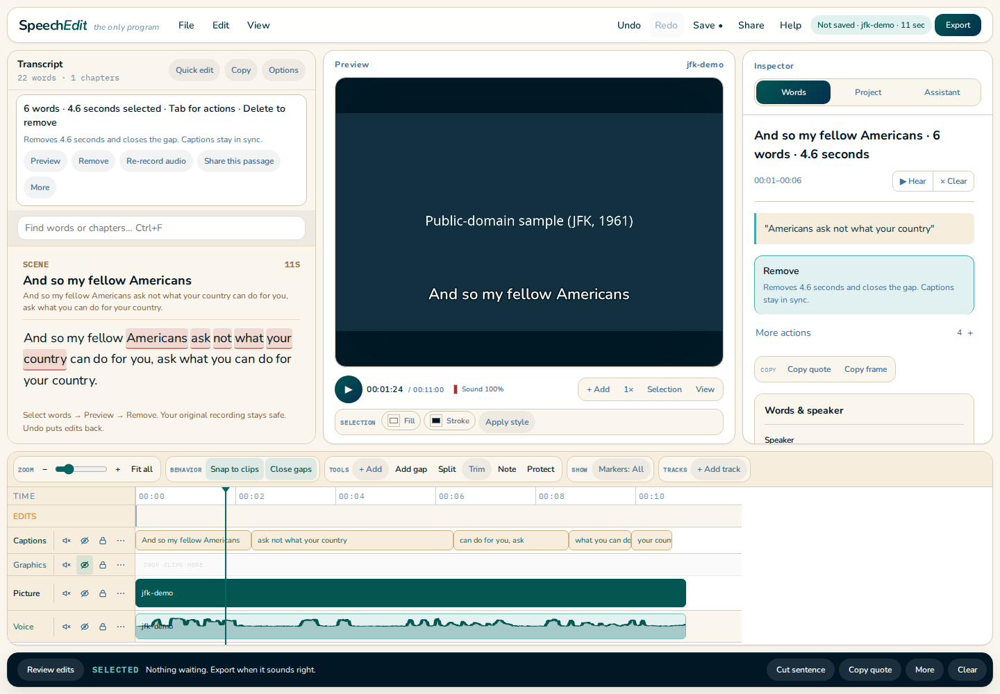
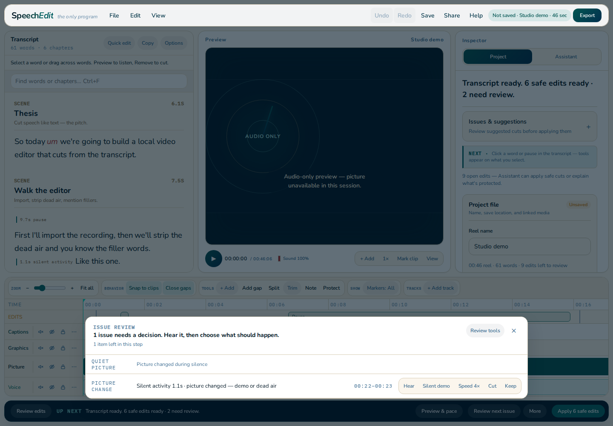
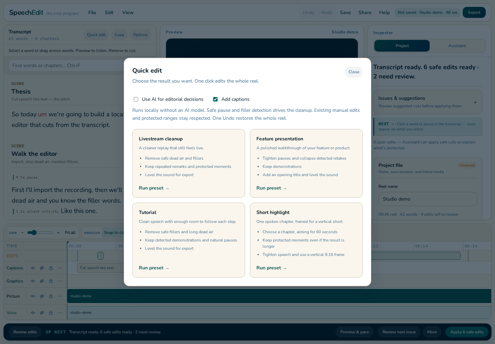
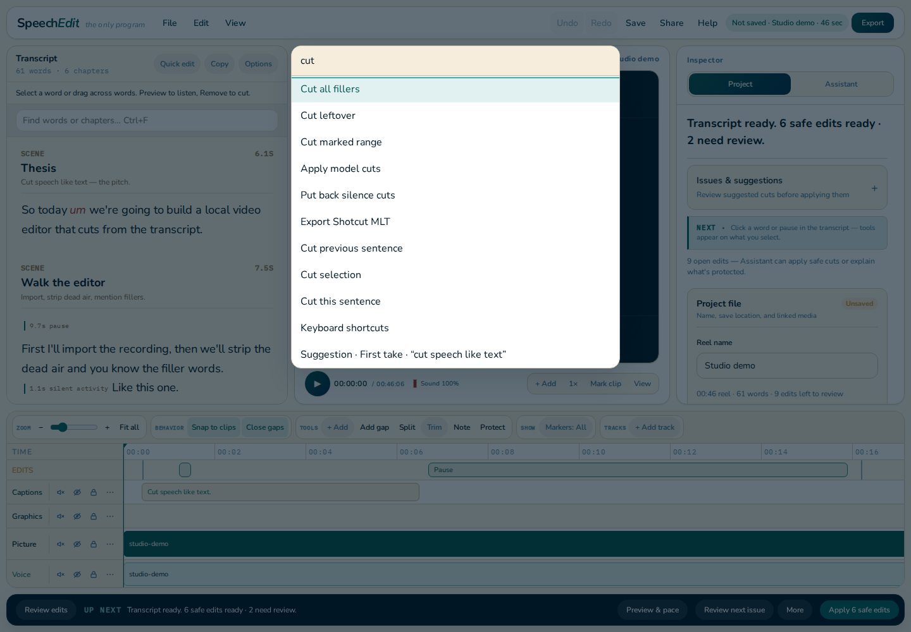

# SpeechEdit: edit video by editing the transcript

**SpeechEdit is a local-first, transcript-based video editor.** Delete words in an auto-generated Whisper transcript to cut the video, strip filler words and dead air with Auto Edit, caption the result, and export through native FFmpeg. It runs as an Electron desktop app (Windows ZIP build available) and as a web app that transcribes in your browser with Whisper.



*The editor after importing an 11-second public-domain speech clip: Whisper produced the word-level transcript and captions, and six words are selected for removal. Captured from the web build.*

## Why SpeechEdit

Cutting a talking-head video, tutorial, screen recording or livestream usually means scrubbing a timeline to find the sentence you want gone. SpeechEdit puts the words in front of you instead: select text, press Delete, and the video, captions and timeline follow. Silence, filler words and repeated takes are detected for you, and every automatic cut is reviewable and undoable.

- **Local-first.** Transcription (Whisper) and rendering (FFmpeg) run on your machine or in your browser. Models for the Assistant are optional.
- **One command bus.** The mouse, keyboard shortcuts, command palette, Assistant and MCP tools all issue the same reversible editing commands, and the project JSON is the source of truth.
- **Real NLE underneath.** A multi-track timeline with razor, ripple, snap, trim, zoom, titles, speed, volume, fades and keyframes, not only a text view.

## Features

**Transcript editing**
- Word-level transcript with click-and-drag selection. **Remove** cuts the selected words, **Restore words** brings them back, **Correct word** fixes a transcription error without touching the audio.
- Import an existing transcript (SRT, VTT, TXT or Whisper JSON) instead of transcribing.
- Chapters are created automatically after transcription; search words and chapters with Ctrl+F.
- Re-record a selected passage in a fixed-length slot with a 3-2-1 countdown; the take replaces only that audio.

**Auto Edit: remove filler words, silence and retakes**
- Detects silence and filler words, static-screen stretches (sped up 4x), loudness and pace, and suggests retake collapses.
- Review each suggestion, apply only the safe cuts, or put applied edits back by type.
- **Quick edit** recipes: Livestream cleanup, Feature presentation, Tutorial and Short highlight (a 9:16 vertical cut aiming for 60 seconds). One Undo reverts a whole recipe.



*Auto Edit issue review on the built-in studio demo reel (audio-only): hear a flagged stretch, then keep it, cut it, speed it up or mark it as a silent demo.*



**Timeline and captions**
- Tracks: V3 captions, V2 overlay, V1 picture, A1 voice. Razor, ripple in/out, snap, trim, move, zoom, titles, B-roll and music.
- Transform, speed, volume, fades and keyframes. Captions are on by default and export burns the program, not a cut list of the source.

**Export and interchange**
- Desktop: render MP4 with native FFmpeg (YouTube 1080, vertical 9:16, podcast audio, optional loudness normalization to -16 LUFS).
- Captions as SRT or VTT, transcript as Markdown or text, YouTube chapter timestamps, and timelines as OpenTimelineIO, Final Cut XML (FCPXML), Premiere XML, Shotcut MLT, Kdenlive or Auto-Editor JSON.
- Import timelines in the same interchange formats.

**Command palette, Assistant and MCP**
- Ctrl+K (Mac: Cmd+K) searches every editing action; Cmd+J opens the Assistant in the Inspector.
- Assistant providers: Ollama, any OpenAI-compatible `/v1` server, Codex CLI or Grok CLI. Without a model it uses local heuristics.
- `bun run mcp` starts a stdio **MCP server** that exposes the editing tools so an AI agent can edit a project.



**Share and collaborate (hosted web editor)**
- Send a review link where reviewers comment, correct transcript words and propose cuts without an account, or a full-editing link for shared changes with conflict handling. Details are in [Share and collaborate](#share-and-collaborate).

## Quick start

SpeechEdit uses [Bun](https://bun.sh). You need `ffmpeg` and `ffprobe` on your PATH for the desktop app and for the hosted review/share server.

**Try it in the browser** (Whisper runs in the page; the first run downloads the model, about 114 MiB):

```bash
git clone https://github.com/dashw00d/speechedit.git
cd speechedit
bun install
bun run build:web
bun run start:web      # http://localhost:3000
```

Open the page, choose **Open media** (or **Studio demo** for a built-in sample reel), and wait for the transcript. The browser edition covers transcript editing, Auto Edit, captions, review links and transcript/caption/timeline export. Rendering the final MP4 needs the desktop app, because it uses native FFmpeg on a recording on disk.

**Run the desktop app from source:**

```bash
bun install
bun run dev
```

See [Run from source](#run-from-source-desktop-app) for WSL notes, and [Windows validation build](#windows-validation-build) for a packaged ZIP that bundles FFmpeg.

## Example: cut a sentence in under a minute

1. **File -> Open media** and pick a recording. Transcription starts automatically.
2. Drag across the words you want gone, for example a false start. The selection shows how many seconds it removes.
3. Press **Remove** (or Delete). The timeline closes the gap, and the original recording stays untouched.
4. Click **Review edits** to see Auto Edit's suggested pause and filler cuts, then **Apply safe edits**.
5. **Undo** reverts any step. **Export** renders the result (desktop) or saves captions and interchange files.

## How it works

```
Transcript / timeline / Auto Edit / shortcuts / palette
                         │
                  editor commands
                         │
                    project store
               ┌─────────┴─────────┐
               ▼                   ▼
        program monitor      FFmpeg export
        (cut-skip, zoom,     (speed, captions,
         captions)            zooms, fades)
```

Every edit is a command (for example `deleteRange` or `setSpeed`) applied to the project store. The program monitor plays the edited result by skipping cuts, and export renders the same program through FFmpeg. The project is saved as `.speechedit.json`. Transcription is pluggable: Whisper on PATH, a local whisper.cpp install, or any OpenAI-compatible speech-to-text API (Speaches, faster-whisper-server, Groq, OpenAI). The web edition uses a Whisper model in the browser, on WebGPU when available and a CPU fallback otherwise.

## Requirements

- [Bun](https://bun.sh) for install, dev server, tests and the web server.
- `ffmpeg` and `ffprobe` on PATH for development and for the hosted share/review server (the Windows ZIP and the Docker image include FFmpeg).
- Desktop: Electron 37 (installed by `bun install`).
- Browser edition: a current Chromium-based browser; HTTPS or localhost for microphone recording. WebGPU is optional.

## Screenshots

The images in `docs/screenshots/` are real captures of the web build using the built-in studio demo and a public-domain JFK sample clip. Regenerate them with `scripts/capture-screenshots.mjs` (see the header of that file for setup).

## Run from source (desktop app)

Needs `ffmpeg` / `ffprobe` on PATH for development. The Windows ZIP bundles both and checks them at startup; if either binary is missing, SpeechEdit shows one recovery message and refuses import and export. Transcription is pluggable: Whisper on PATH, or any OpenAI-compatible ASR (Speaches, faster-whisper-server, Groq, OpenAI). A second local or API model can group scenes and retakes.

```bash
bun install
bun run dev        # Electron desktop app
bun run dev:web    # renderer only, in a browser (studio demo works)
bun test           # unit tests
```

On WSL, if the window never appears: `NO_SANDBOX=1 bun run dev`.

The window title, Preferences, and Project → Advanced show the version and git commit. **Copy build id** pastes a diagnostic for a run record. The desktop window can shrink to 960×600 so a 1280×720 laptop still fits after the taskbar; Alt+1–4 switch Preview / Review / Script / Timeline when a pane is collapsed.

For the path from development build to real-footage dogfooding and private alpha, follow the [real-video validation roadmap](docs/real_video_validation_roadmap.md).

## Web demo deployment

The web demo is a small server application, not a static `dist/` upload. The server serves the built editor, keeps the OpenRouter credential private, forces Assistant requests through `openrouter/free`, and caches browser Whisper model files.

For a command-based Bun service:

```bash
bun install --frozen-lockfile
bun run build:web
bun run start:web
```

Set `OPENROUTER_API_KEY` as a secret in the hosting platform. Do not upload the local `.env`; `.env.example` lists the supported variables without credentials. The service listens on the platform-provided `PORT` (3000 by default), binds `0.0.0.0`, and exposes `GET /healthz`.

For a Docker service, build the included `Dockerfile`, expose port 3000, and mount `/data` if the platform supports persistent volumes. Without a volume the app still works, but the server refetches its Whisper cache after a container replacement. The first browser still downloads and locally caches the approximately 114 MiB browser Whisper model.

### WebGPU on ServerChirp

Serve the public app over **HTTPS** and deploy the full web server plus its matching `src/renderer/dist` build. WebGPU uses the visitor's device; the ServerChirp machine does not need a GPU. The browser must expose WebGPU and return a usable GPU adapter. See the [ONNX Runtime deployment requirements](https://onnxruntime.ai/docs/tutorials/web/deploy.html).

Whisper checks the adapter before loading the GPU model. If GPU initialization or transcription fails, it starts CPU compatibility mode in a fresh worker and automatically retries the recording. **View → Project settings → Whisper transcription** shows the active backend and why compatibility mode was selected. Check that message on the affected browser; HTTPS, browser graphics acceleration, and device drivers can affect GPU availability.

Recording imports start Whisper automatically, including CPU compatibility mode. Finished transcription creates missing chapters while preserving existing chapter edits. If transcription fails, the Transcript panel displays a large **TRANSCRIBE** button to retry. For older projects that already have words but no chapters, click **Find chapters** in the Transcript header. Transcription can also be rerun from **Transcript → Options**; Undo restores the previous result.

Both the ONNX runtime `.mjs` and `.wasm` files ship as versioned assets with the editor. Keep their JavaScript and WebAssembly MIME types intact through the hosting proxy. Runtime loading does not require jsDelivr. Model downloads still use the server's Hugging Face cache, with a direct Hub fallback.

To check a local production build in an isolated Electron browser profile:

```bash
bun run build:web
bun run start:web
# In another terminal; requires a graphical session:
bun run smoke:whisper http://127.0.0.1:3000
bun run smoke:transcription http://127.0.0.1:3000
```

The transcription UI smoke test uses deterministic worker responses to check automatic CPU fallback, chapter creation, and recovery through the Transcribe button.

The Whisper smoke test blocks the runtime CDN, checks that both runtime assets came from this server, initializes Whisper, and transcribes a one-second silent fixture. It reports `webgpu` or `wasm` and any fallback reason. Set `SPEECHEDIT_EXPECT_BACKEND=webgpu` to require a GPU result on a compatible test machine. Run against the same build as the local source; the script uses its worker asset filename.

## Windows validation build

Build the current Windows x64 test package from Windows or WSL:

```bash
bun run package:win
```

The command downloads checksum-pinned FFmpeg 6.1.1 and FFprobe binaries, builds Electron, and writes `release/SpeechEdit-<version>-windows-x64.zip`. Extract the ZIP on Windows and run `SpeechEdit.exe`; Bun, Node, FFmpeg, and FFprobe are not required on the test machine. `bun run package:win:dir` produces the unpacked directory directly for faster packaging diagnostics.

The package is an unsigned internal validation build. Windows may warn before first launch. Local whisper.cpp installs on first transcription; remote transcription remains configurable in Models.

## Everyday editing

- Click a word or drag across several to select them. **Preview** plays the selection; **Remove** cuts it from the recording. Separate word selections leave the speech between them alone.
- Use **Correct word** to fix a transcription mistake. Select crossed-out words and choose **Restore words** to bring them back. **Undo** and **Redo** stay in the top bar.
- Click a pause or chapter to select it without starting playback. Use its explicit preview and editing controls. Double-clicking a pause does not remove it.
- **Trim** on the timeline explains how to remove a clip's beginning or end. Sliders also accept exact numbers. Smaller windows use **Transcript / Preview / Review / Timeline** tabs and preserve your selection as you switch.
- **Save** keeps an editable project; **Export** creates the finished output. **Help** includes a short walkthrough and keyboard shortcuts. **Ctrl+K** (Mac: **⌘K**) finds editing actions.

## What it does that used to take three apps

**ReScript**
- Word-level transcript, fillers, restore
- Drop SRT / VTT / JSON
- Caption remaining words onto V3
- Whisper if installed; speech islands if not

**Shotcut**
- Multi-track tape (V3 captions, V2 overlays, V1 picture, A1 voice)
- Razor, ripple I/O, snap, trim, move, zoom, titles
- Transform / speed / volume / fades / keyframes
- Export burns the program, not a cut list of the source

**Auto-Editor**
- Silence, fillers, static-screen 4×, loudness, pace
- Review or apply safe cuts
- Same `deleteRange` / `setSpeed` as the mouse

`⌘K` is the command palette. `⌘J` opens Assistant in the Inspector (activity and tool results stay there; successful edits are undoable with `⌘Z`). `I` / `O` set marks. Delete ripples them.

## Models and agents

View → Project settings sets transcript + intelligence providers: Ollama, any OpenAI-compatible `/v1` server, Codex CLI, or Grok CLI. **Refresh models / Check CLI** verifies discovery; **Test real reply** runs a structured completion. Model work is serialized through one visible FIFO queue so Assistant, scene analysis, and health checks cannot overload the provider. Edit → Ask assistant… uses local heuristics if no model is configured; otherwise the provider sees the editorial brief and emits the same reversible commands the UI uses.

The CLI providers use the account already signed into each tool. Codex runs its supported headless `codex exec` mode with a read-only sandbox and ephemeral session (`-p` is a profile flag in current Codex versions). Grok runs its single-turn `grok -p` mode with tools/web/subagents disabled. On Windows, SpeechEdit uses the Windows Codex installation and can reach a WSL Grok installation through `wsl.exe`.

```bash
bun run mcp
```

The stdio MCP server exposes the complete editing tool catalog plus project/context/status resources, reusable edit/review/retake prompts, argument completion, structured tool results, and read/write safety annotations. When Electron is running, a local user-only bridge executes tools against the in-memory reel and updates the UI. Otherwise the server uses atomic writes against `~/.speechedit/current.speechedit.json` (or `SPEECHEDIT_PROJECT`). Under WSL it automatically finds the Windows SpeechEdit workspace. Point an MCP client at `bun src/mcp/server.ts`.

Menus follow the scope of the action:

- **File** groups opening, importing, saving, and exporting. **Edit** contains history, command search, review, and Assistant. **View** opens workspace panels, project settings, preferences, and help.
- **Preview or Timeline → + Add** adds titles, labels, captions, zooms, blur, B-roll, and music. Select words or a chapter first to place effects on that range. The first title is an opening title; subsequent titles use the playhead.
- **Selected words → More** contains sentence/paragraph selection, splitting, protection, quote copying, and other word actions. **Selected chapter → Chapter options** contains rename, split, merge, and protection. **Transcript → Options / Copy** contains speakers, captions, chapter labels, notes, chapter text, and SRT export.
- **Timeline** keeps splitting, trimming, gaps, notes, track settings, and dissolves beside the clips. **Clip actions** appears for a selected clip or a copied clip. **Protect marked** appears only when both In and Out are set.
- **Review edits → Review tools** finds and refreshes suggestions, applies available safe or AI cuts, and puts back applied edits by type. Decisions about an individual pause or retake stay beside that selection and in its inspector.
- **Inspector** holds selected-item adjustments and title styles. **View → Project settings → Picture, sound, and export** holds whole-project loudness normalization. **Export** holds output settings and interchange formats, including OpenTimelineIO and FCPXML.

The command palette remains an additional searchable route to advanced actions.


### One-click quick edits

Open **Quick edit** above the transcript (also under **Edit → Quick edit presets**), then click a recipe:

- **Livestream cleanup:** safe dead-air/filler cleanup, natural spacing, and level sound; repeated remarks stay.
- **Feature presentation:** tighter speech, detected retakes removed, an opening title, and level sound.
- **Tutorial:** wider speech padding, only long dead-air cuts, and detected demonstrations preserved.
- **Short highlight:** one spoken chapter, aiming for 60 seconds, tighter speech, and a vertical frame. Existing protected moments stay even when the result is longer. Check framing before export.

Captions are on by default; manual caption/title cards are preserved. Optional **Use AI** sends the transcript to the configured Assistant provider for additional cut suggestions (and a chapter choice for highlights). Local mode makes no AI calls. Only bounded, high-confidence AI cuts are applied; other suggestions remain available for review. AI errors or a 45-second timeout fall back to the local recipe. Cancel or a project change during analysis discards the pending result.

Recipes compose existing commands on a temporary project and commit once. The result shows duration and changes, with Play, Inspect edits, Export, and **Undo this preset**. Export remains a separate action.


Select words and choose **Share this passage** to send a review link that opens at those words with an optional question. For an existing review copy, changing the passage or question reuses the uploaded video. Passage details stay in the URL fragment alongside the access key; the rest of the recording remains available.

**Feedback** in the top bar shows pending suggestions across this project's Audit links. Open it for **Needs review**, original → suggested wording, bounded playback, Accept / Reject / Reply, and **Next pending**. Unsent comments, corrections, chapter titles, and replies recover after a page reload on the same device. Feedback refreshes every 15 seconds while the editor is visible and immediately after your own decisions.

### Re-record selected speech

Select words or a sentence and choose **Re-record audio**. The modal shows the script and exact slot length. Press **Start recording**, allow microphone access, and speak after the 3–2–1 countdown. Capture stops automatically at the end of the slot. Listen, retry, or use the take. **Stop early** leaves silence in the remaining slot and explains how much; it never pulls the next sentence earlier.

The replacement occupies an ordinary audio clip with voice-replacement mixing. The original voice is muted only inside that clip; video, captions, background music, and overall timeline length stay intact. Another take in the same slot replaces the prior take rather than layering voices. Undo restores the previous audio.

In an Audit link, **Send recording suggestion** uploads an MP3 replacement for owner approval. The owner can compare original playback and the proposed recording in the feedback card. Full-editing collaborators can record directly into the shared project. Accepting a recording or bringing shared edits back downloads the MP3 into the owner's local media storage. Authored MP3 takes remain MP3 when shared again. Desktop-only recordings are stored locally as WAV; hosted recording endpoints prepare MP3.

Slots support 0.1–120 seconds. Local/full editing uses the selected passage's current playback duration; Audit recordings use the shared source duration and require a passage without shared cuts. If the owner's timing changes, acceptance refuses a mismatched take. Microphone capture requires HTTPS or localhost in a browser. Server recording routes centralize conversion and upload limits; payment plans are not implemented.

### Share and collaborate

In the hosted web editor, choose **Share → Full editing → Create editing link**. The link opens the same editor: timeline, transcript, chapters, captions, titles, B-roll, effects, keyframes, audio mixing, and normal editing tools. Collaborators can add recordings, music, and images. Changes automatically save to the shared project every few seconds; **Save now** and the normal Save shortcut also sync them. The sharing owner can use this link for their own remote work.

New links default to **Audit** to collect timestamped comments, replies, transcript corrections, voice replacement recordings, proposed cuts, and chapter renames. Reviewers need no account: they enter a name, select a word, and suggest its correction. Reasons are optional for edits. To select a passage on a phone, tap its first word, choose **Select through another word**, and tap its last word; Shift-click also works on desktop. Feedback refreshes automatically while the owner’s Share dialog is open. Audit changes reach the owner's project only through **Accept edit**. Acceptance uses normal editing commands and is undoable. Existing audit links retain their original permissions and immutable source snapshot.

Both modes upload compressed previews of source recordings. Authored microphone MP3 takes are retained without another encode; original video files stay on the creating device. Video defaults to a maximum 640×360 at 8 fps, approximately 180 kbit/s VP8 plus continuous 48 kbit/s stereo Opus audio. The fast WebCodecs path samples only the required preview frames, uses low-latency VP8 encoding, and reads local files directly. Completed previews are reused from a bounded 128 MiB local cache when the same recording is shared again. The sharing progress shows the active encoder and estimated time remaining; browsers with unsupported codecs fall back to playback-speed capture and must keep the tab visible. Images use WebP at up to 960 pixels. Interframe video reuses visual information between frames, keeping low-frame-rate playback compact without maintaining a separate image-sequence player. A failed encoder never falls back to uploading originals.

Full editing retains the editable project and previews of all its media. Local file paths, browser storage keys, thumbnails, and private local metadata are stripped. The shared editor uses separate draft storage and never hydrates or overwrites the owner's local workspace. Names in the last 100 save entries are self-reported. Link possession grants its stated access; editing links grant immediate changes to the shared project.

Saves use optimistic revisions. Independent edits to stable editorial objects merge; edits to the same value, conflicting ordering, and edit/delete collisions require an explicit choice. The shared editing bar offers a downloadable draft and conflict resolution. Unsaved drafts persist in separate IndexedDB storage; network failures leave them pending. Incoming shared updates reset local undo history so Undo cannot accidentally roll back another person's changes.

The owner chooses **Share → Bring shared edits into this project** to merge remote work onto local originals in one undo step. Conflicting local work blocks the merge. New media contributed remotely stays marked as preview-only until its original is relinked. Final video/audio rendering is blocked while preview-only assets remain. Shared document and transcript exports remain available. Native desktop link creation is not enabled yet; create/manage links in the hosted editor.

Links expire after 30 days. The owner can revoke a link and delete its previews and metadata. Owner capabilities live in the creating browser; clearing its storage loses management access and the merge baseline. Save your local project after pulling shared edits or accepting feedback.

Production needs FFmpeg (included in Docker) and persistent `SPEECHEDIT_REVIEW_DIR` storage (default `/data/reviews`). FFmpeg indexes/remuxes already-compressed WebM into seekable previews. Uploads use 512 KiB chunks, with limits of 250 MiB per file, 1 GiB per room, 8 MB metadata, and 20 GiB total storage. Full projects support 256 media assets. Expired rooms are reclaimed during capacity checks. Filesystem leases coordinate overlapping deployments, and atomic replacement protects completed metadata writes; all instances must share the same storage filesystem.

API clients use the ID and fragment key (the part before the first `&` for passage links) from `/edit/ID#KEY` or `/review/ID#KEY`, with `Authorization: Bearer KEY`:

- Owner-only `GET /api/reviews/ID/summary`: pending/total feedback counts and review name, without downloading the transcript.
- `POST /api/reviews/ID/recordings`: microphone WAV body, `Content-Type: audio/wav`, `X-Recording-Duration` in seconds. Returns an immutable authored MP3 asset for either shared editing or a `{ kind: "replaceAudio", start, end, assetId }` proposal.
- `POST /api/recordings`: prepares a local hosted-editor take as MP3 and returns the audio body; persistence happens in local browser media storage.
- `GET /api/reviews/ID`: room, sanitized project (editing links), project revision, recent saves, and feedback.
- `PUT /api/reviews/ID/project`: `{ revision: projectRevision, project, author }`; full-edit links only. Invalid media references and stale revisions are rejected.
- `POST /api/reviews/ID/assets`: `{ asset }` registers new immutable media for an editing link; upload its compressed preview with `PUT /api/reviews/ID/media/ASSET_ID` before saving the project.
- `POST /api/reviews/ID/proposals`: `{ revision, author, text, edit: { kind: "cut", start, end } }`, or `{ kind: "renameChapter", sceneId, title }` or `{ kind: "correctWord", wordId, text }` for `edit`. Reasons (`text`) are optional for edits. Omit `edit` and include `start`/`end` for a comment.
- `POST /api/reviews/ID/proposals/PROPOSAL_ID/reply`: `{ revision, author, text }`.
- Owner-only `POST /api/reviews/ID/proposals/PROPOSAL_ID/resolve`: `{ revision, status: "accepted" | "rejected" }`. Applying audit decisions onto originals happens in the owner's editor.

A stale revision returns 409. The key never appears in API URLs. Media uses a room-scoped HttpOnly cookie established by an authenticated room read. Never distribute the owner key as a collaborator link.

Run `bun run smoke:edit http://127.0.0.1:3000` or `bun run smoke:review http://127.0.0.1:3000` against a production web build/server. They use deterministic Whisper results with real compression, upload, independent browser sessions, editing/review, owner merge/acceptance, undo, and revocation. Set `SPEECHEDIT_REVIEW_VIDEO=1` for video. Synthetic fixtures are revoked afterward.

## License

MIT. See [LICENSE](LICENSE).
